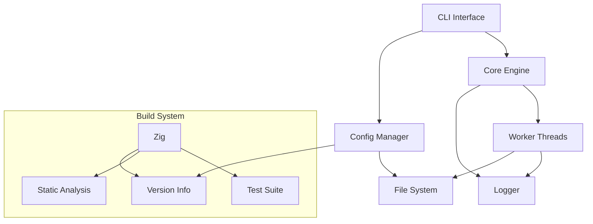
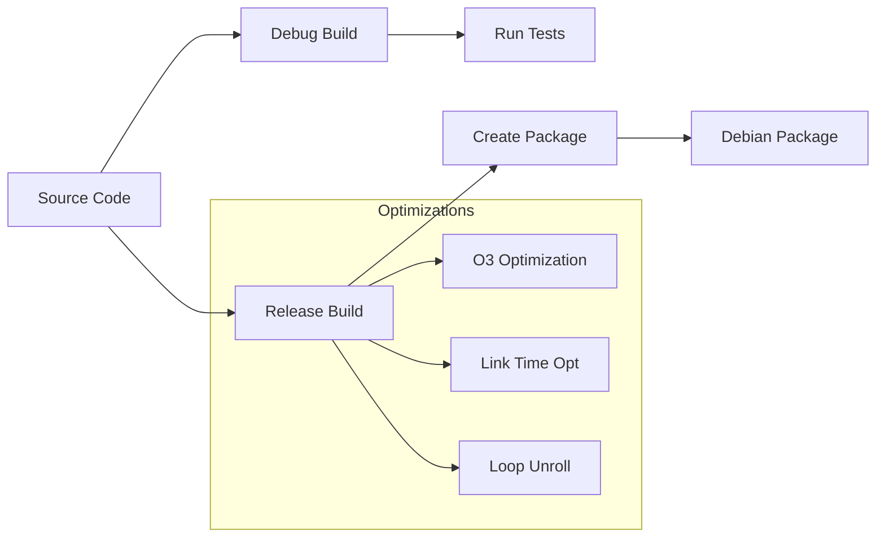
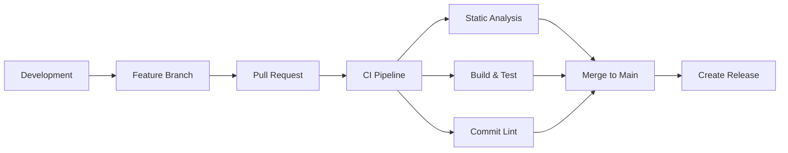

# Timbre Architecture

## Overview

Timbre is a Zig application that filters stdin through regex rules and writes categorized log files. The codebase is small and modular: CLI parsing, configuration, logging, and the core line-matching loop are separate compilation units, built with Zig’s native build system.

## Component Architecture



## Key Components

### Build System
- Zig-based build system
- Multi-architecture support (x86_64, arm64)
- Integrated static analysis (clang-tidy, cppcheck)
- Automated testing with Zig test runner
- Version management system

### Core Components

- **CLI** (`src/cli.zig`): Argument parsing and help text
- **Config** (`src/config.zig`): TOML configuration and log-level rules
- **Log** (`src/log.zig`): File output and terminal behavior
- **Timbre** (`src/timbre.zig`): Core filtering pipeline
- **Main** (`src/main.zig`): Entry point and wiring

## Build Configurations



## Development Workflow



## File organization

```
timbre/
├── src/
│   ├── main.zig              # Entry point
│   ├── timbre.zig            # Core filtering
│   ├── config.zig            # TOML configuration
│   ├── log.zig               # Log file I/O
│   ├── cli.zig               # CLI parsing
│   └── integration_test.zig  # Integration tests
├── regex/                    # Bundled regex library (Zig)
├── cfg/                      # Example timbre.toml
├── docs/                     # Documentation (MkDocs source)
├── build.zig                 # Build definition
└── Dockerfile                # CI / dev container image
``` 